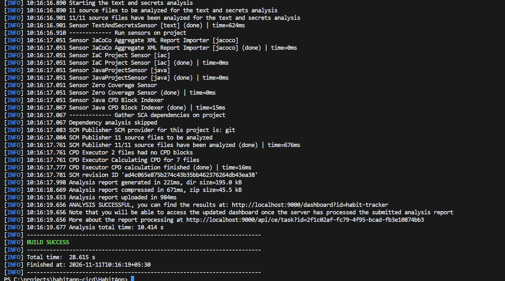
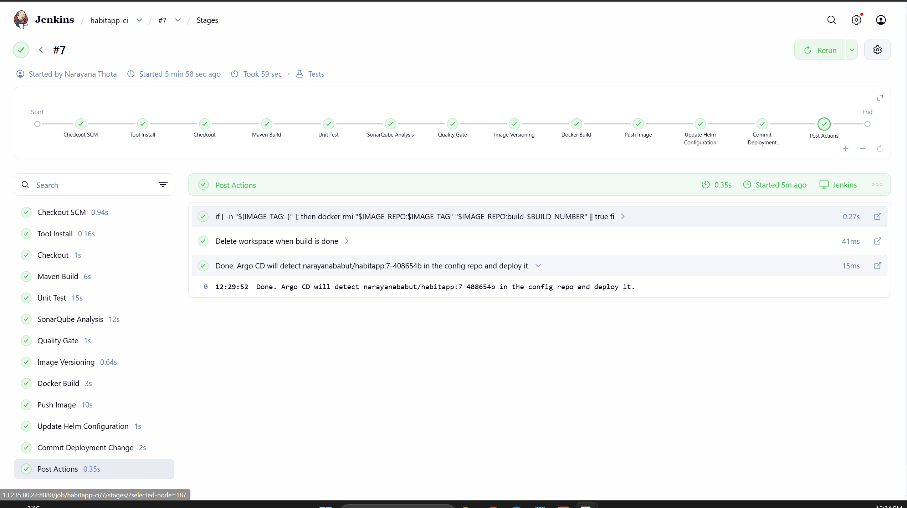
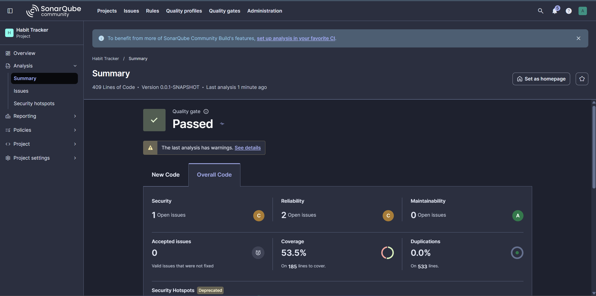
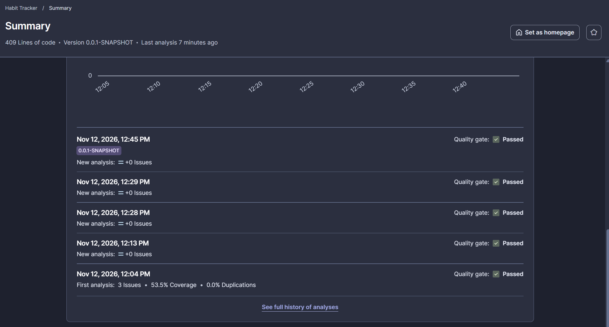
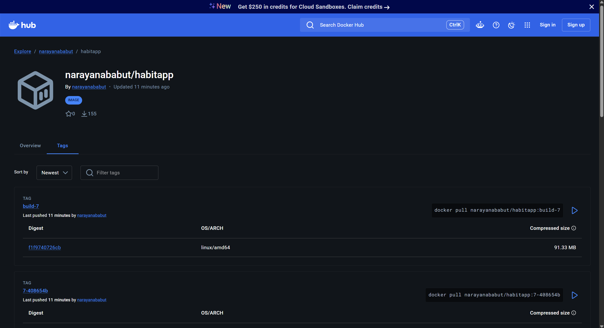
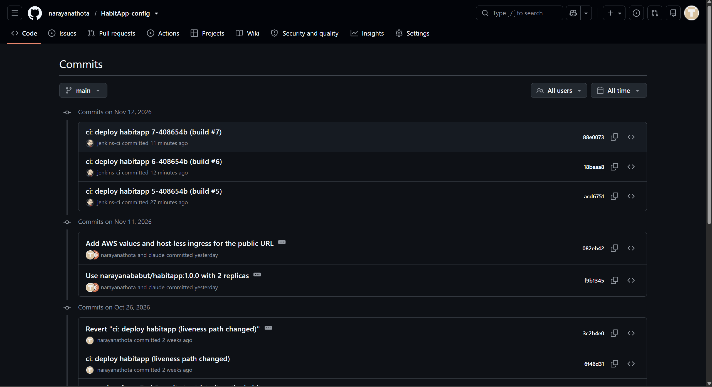
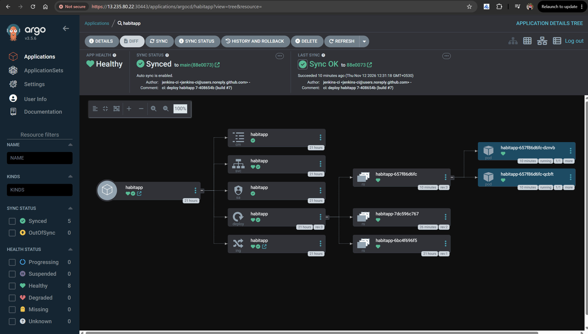
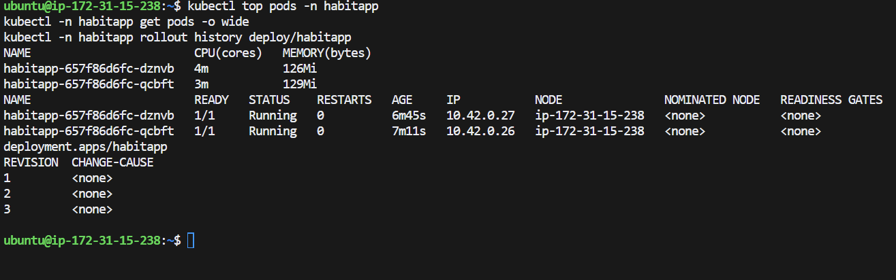
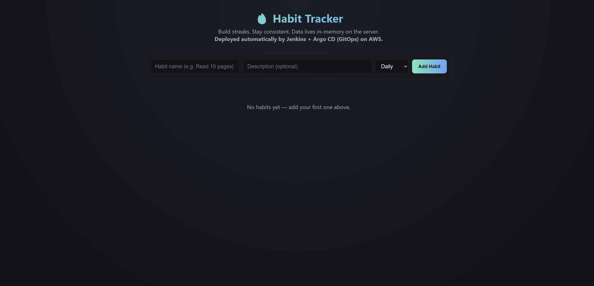
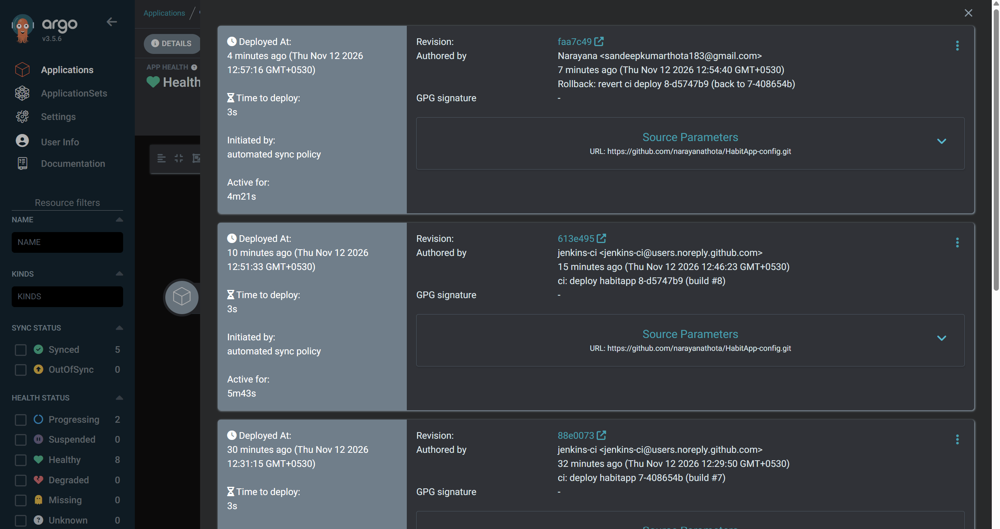

# Screenshots (evidence)

Evidence for the HabitApp CI/CD project (Jenkins, Maven, SonarQube, Docker Hub, Helm, Argo CD on AWS).
Public app: http://13.235.80.22/ . Screenshots were taken on 11-12 Nov 2026.

## What we did, in order

1. **Rehearsed locally:** built and tested the app with Maven and ran a SonarQube scan from the PC.
2. **Built the CI server on AWS:** one EC2 VM running Jenkins, SonarQube, k3s and Argo CD.
3. **Ran the Jenkins pipeline** (13 stages): checkout, build, unit tests, SonarQube scan, Quality Gate,
   image tag, Docker build, push to Docker Hub, update the Helm values in the config repo, commit.
4. **Argo CD (GitOps)** noticed the new tag in the config repo and deployed it to Kubernetes by itself.
5. **Checked the running app:** 2 pods healthy, CPU and memory low, no restarts.
6. **Changed the app** (added a banner), pushed it, and Jenkins and Argo CD put it live without manual steps.
7. **Rolled back** by reverting one Git commit in the config repo. Argo CD restored the previous version.

## The screenshots

| # | File | What it shows | What it proves |
|---|---|---|---|
| 1 | `01-local-sonar-scan-build-success.png` | Maven `sonar:sonar` on the PC ends with `ANALYSIS SUCCESSFUL` and `BUILD SUCCESS` (local rehearsal, `localhost:9000`) | The code builds and the SonarQube scan works before AWS was used |
| 2 | `02-jenkins-build7-all-stages-green.png` | Jenkins `habitapp-ci` build #7: all 13 stages green in 59 s, final message "Argo CD will detect narayanababut/habitapp:7-408654b" | The full CI pipeline runs end to end with no manual steps |
| 3 | `03-sonarqube-quality-gate-passed.png` | SonarQube project Habit Tracker: Quality gate **Passed**, 409 lines, coverage 53.5%, duplications 0.0%, maintainability A | Code quality is checked and passes the gate |
| 4 | `04-sonarqube-analysis-history-all-passed.png` | Five analyses on 12 Nov (12:04, 12:13, 12:28, 12:29, 12:45), every one Quality gate Passed | Every pipeline run is scanned by SonarQube and gated |
| 5 | `05-dockerhub-tags-build7.png` | Docker Hub `narayanababut/habitapp` (public): tags `7-408654b` and `build-7`, linux/amd64, 91.33 MB | Jenkins pushes versioned images (`<build>-<commit>`) to the registry |
| 6 | `06-config-repo-jenkins-ci-commits.png` | `HabitApp-config` commits by `jenkins-ci`: "ci: deploy habitapp 5-, 6-, 7-408654b (build #5, #6, #7)" | Jenkins updates the image tag in Git; Git is the source of truth |
| 7 | `07-argocd-synced-healthy-build7.png` | Argo CD app `habitapp`: **Healthy**, **Synced** to `main (88e0073)`, Sync OK, auto-sync on, 2 pods running 1/1, ReplicaSets rev 1 to 3 | Argo CD deployed exactly what is in Git and the app is healthy |
| 8 | `08-kubectl-pods-top-rollout-history.png` | `kubectl top pods`, `get pods -o wide`, `rollout history`: 2 pods Running, 0 restarts, 3-4 m CPU, about 128 Mi memory, 3 revisions | Monitoring and troubleshooting commands; rolling updates have happened |
| 9 | `09-app-live-with-cicd-banner.png` | The Habit Tracker page with the new line "Deployed automatically by Jenkins + Argo CD (GitOps) on AWS." | A code change reached the running app through the pipeline |
| 10 | `10-argocd-history-rollback-via-git-revert.png` | Argo CD History and Rollback: `613e495` (jenkins-ci, build #8) then `faa7c49` "Rollback: revert ci deploy 8-d5747b9 (back to 7-408654b)", both "initiated by automated sync policy", 3 s to deploy | Rollback is a Git revert, deployed by Argo CD with no manual `kubectl` |

## Images

Tokens and passwords are never shown in these screenshots.
